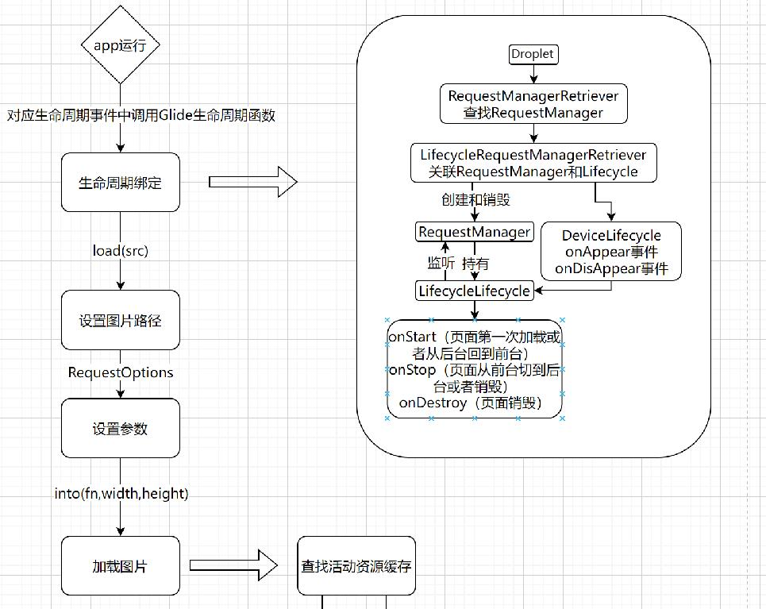

<div align="center">
<h1>droplet</h1>
</div>

<p align="center">


</p>

## 介绍

droplet是一个图像加载缓存库，致力于更高效、更轻便、更简单地加载图片。在图片列表滚动的时候实现平滑滚动的效果。


### 特性

本项目参考开源库Glide移植开发

- 🚀 支持生命周期管理。

- 🚀 支持静态图像加载。

- 💪 支持设置加载中和加载失败图片以及压缩图。

- 🛠️ 加载 gif 图片资源。

- 🌍 支持三级缓存策略。

- 🚀 支持transform图像变换效果。

- 🚀 支持过渡动画。

- 🚀 支持自定义组件的形式加载图片。


## 软件架构

### 架构图

<p align="center">


</p>

架构图文字说明，包括模块说明、架构层次等详细说明。

### 源码目录

```shell
├── README.md                                 #整体介绍
├── doc                                       #文档目录
│   ├── assets                                #文档资源目录
│   └── feature_api.md                        #API接口文档
├── library                                   #源码目录 
├── entry                                     #示例目录
└── hvigor                                    #构建工具目录
```

### 接口说明

主要类和函数接口说明详见 [API](./doc/feature_api.md)


## 使用说明

### 编译构建

描述具体的编译过程：

```shell
    1.先通过命令把代码下载下来,
      git clone -b 具体分支名 https://gitcode.com/Cangjie-TPC/droplet.git
          
    2.选择library模块,点击Build菜单,然后点击 Make Module 'library' 等待编译完成,项目则编译成功
    
```

### 功能示例

#### 1. 把droplet作为三方库依赖引入

```cj
用户如何在自己项目里引入droplet，具体步骤如下：
1. 在自己项目的根目录下,建一个thirdparty目录,然后通过git命令,把自己需要的ijk分支拉下来,比如
   git clone -b 分支名  https://gitcode.com/Cangjie-TPC/droplet.git
2. 把 thirdparty文件下的droplet项目用deveco编译通过，方法如上面的编译构建
3. 在自己项目的根目录的build-profile.json5文件里的modules节点下添加
    {
      "name": "library",
      "srcPath": "./thirdparty/droplet/library"
    },
    {
      "name": "droplet_ffi",
      "srcPath": "./thirdparty/droplet/droplet_ffi"
    }
   把droplet库的两个依赖变为modeule依赖形式.然后同步项目
4. 在自己项目的enrty里的oh-package.json5里的dependencies里加上 "library": "file:../thirdparty/droplet/library",然后同步项目
    "dependencies": {
    "library": "file:../thirdparty/droplet/library"
  }
   项目即依赖成功
   另外注意该项目需要网络权限
```


#### 2. 在UI代码中使用Droplet组件（DropletImageComponent）
功能示例描述: 加载一个网络图片，支持的图片类型为：bmp、jpg、png、wbep、gif。

示例代码如下：

```cangjie
package ohos_app_cangjie_entry

import ohos.component.*
import ohos.state_manage.*
import ohos.state_macro_manage.*
import ohos.base.*
import ohos.ability.*

import ohos_app_cangjie_entry.js.globalAbilityContext
import cj_res_entry.app
import droplet.droplet.*

@Entry
@Component
class MyView {

	@State var label: String = "MyView"

    @State
    var option: DropletRequestOption = DropletRequestOption (
         //网络图片
         loadSrc: "http://www....../testjpg.jpg", 
         //本地图片
         //loadSrc: "/data/storage/el1/bundle/testjpg.jpg",   
         //加载raw文件图片
         //loadSrc："raw1.png"  //要加载的raw文件夹下图片名称
         //读取res下的资源文件
         //loadSrcRes: @r(app.media.startIcon), //loadSrc和loadSrcRes二选一 二者都存在的话loadSrc优先
         placeholder: @r(app.media.loading),             // 占位图使用本地资源icon_loading（可选）自己定义
         errholder: @r(app.media.img),                   // 失败占位图使用本地资源icon_failed（可选） 自己定义
         strategy: DiskCacheStrategyDATA(),       // 磁盘缓存策略（可选）
         signature:"1111", //不同的signature可保证缓存key的唯一    （可选）   
         transformCate:RoundedCorners(50), //transform效果 （可选）
         transitionOption:TransitionOption(TransitionType.Opacity,0.0,1.0,1000)  //过渡动画 （可选）
    )

    protected open func aboutToAppear(){
        Droplet.get(globalAbilityContext.getOrThrow()).onAppear(label)  //onAppear和onDisAppear一起使用，参数和组件的label保持一致,
    }               
    
    protected open func aboutToDisappear(){
        Droplet.get(globalAbilityContext.getOrThrow()).onDisAppear(label) //onAppear和onDisAppear一起使用,参数和组件的label保持一致
    }

    func build() {
        Column(30) {
            Column() {
                DropletImageComponent(
                    //控件宽度 支持百分比和vp 可选 //建议都设置(宽高默认为100%percent) 
                    imageViewWidth: Length(50, unitType: LengthType.percent), 
                    //控件高度 支持百分比和vp 可选 //建议都设置(宽高默认为100%percent) 
                    imageViewHeight: Length(120.0, unitType: LengthType.vp), 
                    //图片相对控件对齐方式 默认ImageFit.Scale 可选
                    imageFit: ImageFit.Contain,
                    //context对象
                    globalContext:globalAbilityContext, //(必选)
                    //droplet选项
                    dropletOption: option,//(必选)
                    // 生命周期标签 同一个页面不同组件保持相同的标签,
                    label: label,
                    resourceFn: {
                        pixelMap =>
                        var width = pixelMap.getImageInfo().size.width
                        var height = pixelMap.getImageInfo().size.height
                        AppLog.error("droplet--- resourceFn width=${width} height=${height}") 
                    }, //加载成功的回调 可以获取显示在控件上的图片的宽和高
                    failedFn: {
                        e => AppLog.error("droplet--- failedFn")
                    }  //加载失败的回调
                )
            }.width(100.percent)
        }
    }

}


```

执行结果如下：
图片在手机上成功展示。

```shell
load成功
```

#### 3. preload预加载的使用,将图片加载到内存，使用时候直接从内存取
示例代码如下：
```cangjie
    //urlList为图片的url列表
    //preload参数为预期的pixelmap宽高 
    Button("preload").onClick{
        for(i in 0..urlList.size){
            Droplet.withContext(stageContext.getOrThrow()).load(urlList[i]).preload(1400,1400)
        }
    }

    //使用时候需要由于内存的key是和预期的pixelmap宽高有关联的，所以需要指定 overrideWH: (1400, 1400)和preload(1400,1400)的宽高一致，
    //这样内存的key才能找到，要是不一样，内存无法找到对应的值

    var option: DropletRequestOption = DropletRequestOption(
        loadSrc: urlList[i],
        placeholder: Option<CJResource>.Some(@r(app.media.loading)),
        errholder: Option<CJResource>.Some(@r(app.media.img)),
        overrideWH: (1400, 1400)
    )

    DropletImageComponent(
        globalContext: stageContext.getOrThrow(),
        dropletOption: option,
        imageViewWidth: Length(50.0, unitType: LengthType.percent),
        imageViewHeight: Length(20.0, unitType: LengthType.percent),
    )

```


#### 4.获取原图的宽高
示例代码如下：

```cangjie
   
         var url = "https://xxxxxxxx"

         Droplet.withContext(globalAbilityContext.getOrThrow())
                .load(url)
                .listener(
                    {
                        drawable: Drawable, model: Model, target: Target<Drawable>, datasource: DataSource, 
                        isFirstResource: Bool =>
                        var width = drawable.getPixelMap().getImageInfo().size.width
                        var height = drawable.getPixelMap().getImageInfo().size.height
                        AppLog.error("原图宽为width=${width} 原图高为height=${height}")
                        //可以获取原图的宽高
                        return false
                    },
                    {
                        e: DropletException, model: Model, target: Target<Drawable>, isFirstResource: Bool => return false
                    }
                )
                .into(
                    Downsampler.SIZE_ORIGINAL,
                    Downsampler.SIZE_ORIGINAL
                )

```


## 约束与限制

DevEco Studio (5.1.0) Release
Cangjie Support Plugin 5.1.0.828
Cangjie Compiler: 1.0.0

## 开源协议

本项目基于 [Google License](./LICENSE) ，请自由的享受和参与开源。

## 参与贡献

欢迎给我们提交PR，欢迎给我们提交Issue，欢迎参与任何形式的贡献。